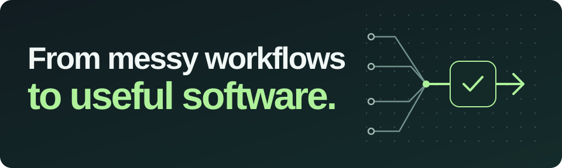

# Tomás Garbarino

**Product Engineer · Argentina**

I build web products and internal tools for work that still takes too many tabs, handoffs, and copy-pastes. I work across the interface, integrations, and deployment, and design AI workflows people can review before they act.

[Portfolio](https://tomas-garbarino.vercel.app/) · [LinkedIn](https://www.linkedin.com/in/tomas-garbarino/)

## Try something I built

- **EdgeBridge KVM** · Move your cursor across the edge of one Windows PC to use the same mouse and keyboard on another. [Download](https://github.com/tomigarbarino/edgebridge-kvm/releases/latest) · [Code](https://github.com/tomigarbarino/edgebridge-kvm)
- **Deliverable Orchestrator** · Turn recurring updates into drafts with sources attached, then approve them before sending. [Open demo](https://orquestador-entregables-tomas.vercel.app/?caso=avance) · [Code](https://github.com/tomigarbarino/orquestador-entregables)
- **Editorial Evidence Gate** · See how an evidence check handles an unsupported claim in an AI draft. [Review a sample](https://github.com/tomigarbarino/editorial-evidence-gate/blob/main/examples/review.md) · [Code](https://github.com/tomigarbarino/editorial-evidence-gate)

I also built [Triage Backlog](https://github.com/tomigarbarino/triage-backlog), a Claude Code skill that checks bug reports and feature requests against the codebase before ranking them.

## Product work at Flock I+D

- **[Agora](https://tomas-garbarino.vercel.app/en/agora)** · Recruiting workflows, candidate experience, and AI-assisted matching.
- **[Trainly](https://tomas-garbarino.vercel.app/en/trainly)** · Learning and competency validation. I work on product flows, frontend, and AI integration.

My background is in frontend engineering and frontend leadership. Most of my web work uses TypeScript, React, and Next.js.
