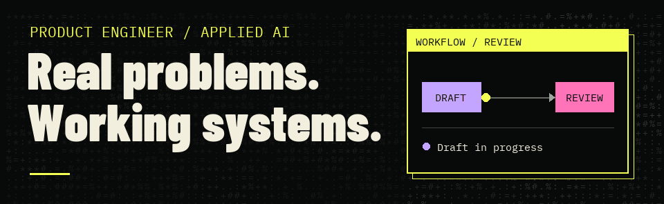
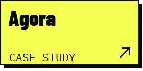
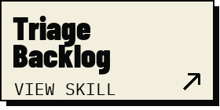

<a href="https://tomas-garbarino.vercel.app/">
  <picture>
    <source media="(prefers-reduced-motion: reduce)" srcset="assets/portfolio-banner-static.png">
    
  </picture>
</a>

# Tomás Garbarino

**Product Engineer / Applied AI · Argentina**

I take AI features from customer discovery through product decisions, implementation, and validation. At Flock I+D, I work on recruiting and learning products, where knowing when to ask for human review is part of the design.

[Portfolio](https://tomas-garbarino.vercel.app/) · [LinkedIn](https://www.linkedin.com/in/tomas-garbarino/)

## Product case studies

- **Agora** · As Product Owner, I helped design a path to human review when missing hiring criteria made the AI match score misleading.
- **Trainly** · I work on the frontend and AI integration that connect company knowledge with conversational assessment.

[Read the JEV research behind Agora's matching decisions](https://tomas-garbarino.vercel.app/writing/jev)

## Public projects

Draft recurring updates with evidence, inspect an AI review, share a mouse and keyboard between two PCs, or triage a backlog against the codebase.

Source code · [Orchestrator](https://github.com/tomigarbarino/orquestador-entregables) · [Evidence Gate](https://github.com/tomigarbarino/editorial-evidence-gate) · [EdgeBridge](https://github.com/tomigarbarino/edgebridge-kvm)
