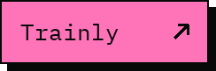

<a href="https://tomas-garbarino.vercel.app/">
  <picture>
    <source media="(prefers-reduced-motion: reduce)" srcset="assets/portfolio-banner-static.png">
    
  </picture>
</a>

# Tomás Garbarino

**Product Engineer / Applied AI · Argentina**

I connect customer discovery, product decisions, and hands-on AI implementation. I build web products and internal tools for work that still takes too many tabs, handoffs, and copy-pastes.

[Portfolio](https://tomas-garbarino.vercel.app/) · [LinkedIn](https://www.linkedin.com/in/tomas-garbarino/)

## Try something I built

Move your cursor across the edge of one Windows PC to use the same mouse and keyboard on another. [Code](https://github.com/tomigarbarino/edgebridge-kvm)

Turn recurring updates into drafts with sources attached, then approve them before sending. [Code](https://github.com/tomigarbarino/orquestador-entregables)

See how an evidence check handles an unsupported claim in an AI draft. [Code](https://github.com/tomigarbarino/editorial-evidence-gate)

I also built [Triage Backlog](https://github.com/tomigarbarino/triage-backlog), a Claude Code skill that checks bug reports and feature requests against the codebase before ranking them.

## Product work at Flock I+D

Recruiting workflows, candidate experience, and AI-assisted matching.

Learning and competency validation. I work on product flows, frontend, and AI integration.

My background is in frontend engineering and frontend leadership. Most of my web work uses TypeScript, React, and Next.js.
